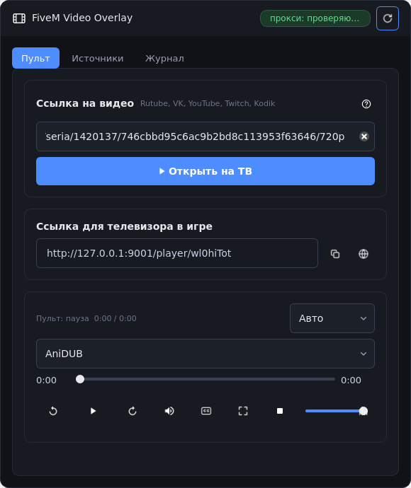
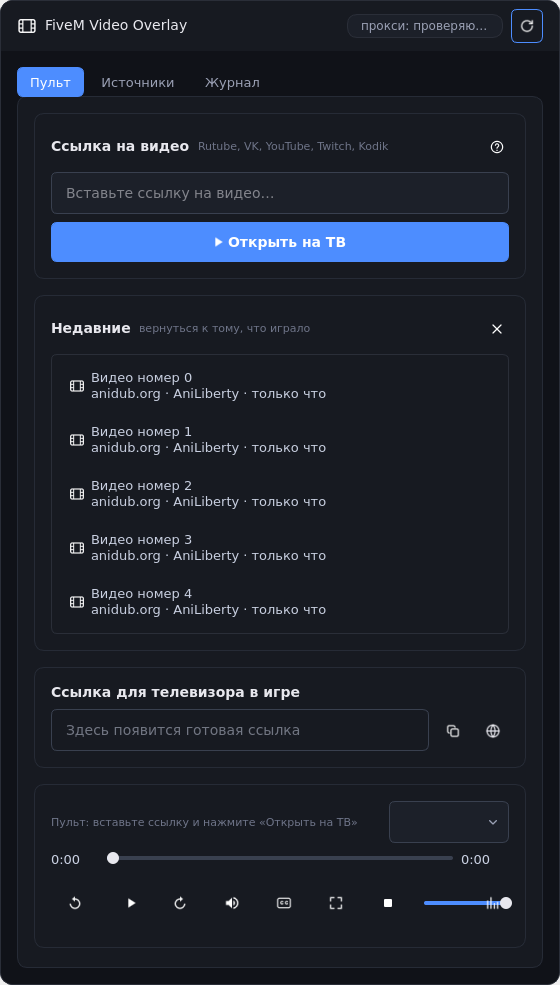
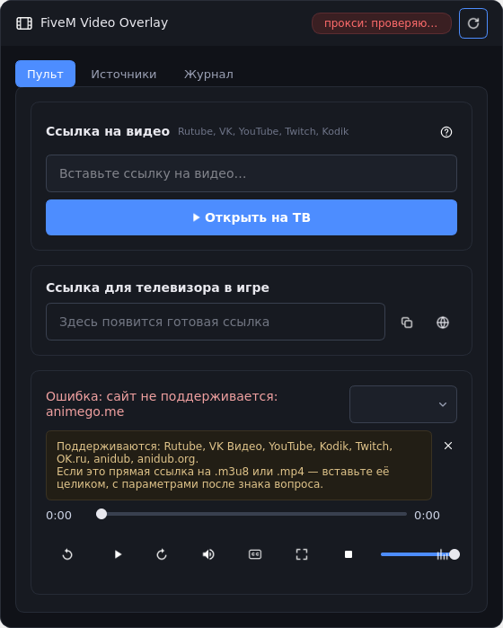
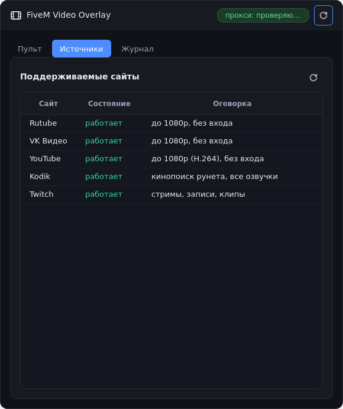
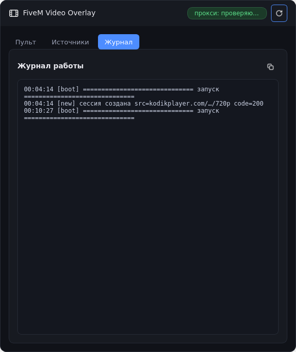
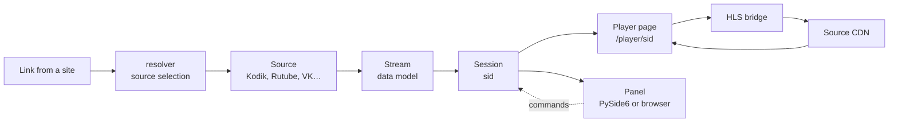

<p align="center">
  <picture>
    <source media="(prefers-color-scheme: dark)" srcset="docs/images/logo-dark.svg">
    
  </picture>
</p>

<h1 align="center">FiveM Video Overlay</h1>

<p align="center">
  A control panel and web player that turn a video link into a stream<br>
  and show it on an in-game screen in GTA 5 (FiveM).
</p>

<p align="center">
  <a href="https://github.com/Ven4esters/FiveM-TV-Overlay/actions/workflows/ci.yml"></a>
  <a href="README.md"></a>
  <a href="LICENSE"></a>
  
  
</p>

<p align="center">
  <a href="README.md">Русский</a> · <b>English</b>
</p>

---

> [!NOTE]
> Russian is the primary language of this project: [`README.md`](README.md).
> This file mirrors it in English and is kept in sync by hand.

## Contents

- [Description](#description)
- [Features](#features)
- [Screenshots](#screenshots)
- [Requirements](#requirements)
- [Quick start](#quick-start)
- [Building the .exe](#building-the-exe)
- [Verifying the file](#verifying-the-file)
- [Usage](#usage)
- [HTTP API](#http-api)
- [Architecture](#architecture)
- [Tests](#tests)
- [Limitations](#limitations)
- [FAQ](#faq)
- [Security](#security)
- [License](#license)

---

## Description

FiveM Video Overlay solves one problem: playing internet video on a GTA 5 (FiveM)
server screen, the way a TV would play it.

A link from a site (Rutube, VK, YouTube, Twitch, Kodik and others) goes to a local
server. The server finds the real stream inside the page and serves it to a player
page that the game client opens. At the same time a desktop control panel lets you
pick a season episode and a dub, change quality, pause, seek, set volume, and jump
back into recent videos.

The project is aimed at FiveM server administrators and at anyone reproducing this
setup. It is not a downloader and not a media server: nothing is stored, no files
are downloaded, and every stream is requested fresh each time.

## Features

- **11 sources** in one chain: Rutube, VK Video, YouTube, Twitch, OK.ru, Kodik,
  Kodik (embed), YummyAnime, Tvigle, anidub, anidub.org.
- **Episodes and dubs** switch on the fly for Kodik, anidub and YummyAnime,
  without restarting the player; other sources simply have no switcher.
- **Manual quality or Auto**: 1080p down to 360p, whenever the site offers them.
- **Resume where you left off**: Recent items remember the position and reopen
  the video at the same minute.
- **A PySide6 control panel** plus the same page in a phone browser, so you can
  drive it from wherever is convenient.
- **A single .exe build**: `build.bat` produces a standalone file that needs
  no installed Python and writes `.md5` and `.sha256` checksums next to it.
- **A memory benchmark in the box**: `tools/bench_memory.py --quick` reports RSS
  per stage; the server takes **40 MB** at startup and **44 MB** under load.
- **A refusal instead of silence**: when a site is unsupported, the panel names
  the reason and lists what is supported (see the screenshot below).

## Screenshots

The panel, tab "Control": a link field, the "Open on TV" button, the ready-made
link for the game client, and the player controls.

<p align="center">
  
</p>

"Recent": what has already played, with its source and dub:

<p align="center">
  
</p>

When a site is unsupported the panel does not stay silent: it names the site and
lists supported sources.

<p align="center">
  
</p>

A source table with an honest state per site, "works" or "partial", plus a note on
exactly what is missing (tab "Sources"):

<p align="center">
  
</p>

<details>
<summary>One more: the work log</summary>

<p align="center">
  
</p>

</details>

> [!NOTE]
> The demo recording (GIF) is not made yet: see the checklist in
> `docs/images/README.md`. Every image above is a real application screenshot,
> not a mockup.

## Requirements

| Component | Minimum | Check | Why |
|---|---|---|---|
| Python | 3.10 (tested on 3.12 and 3.13) | `python --version` | the language |
| 64-bit system | — | `python -c "import sys; print(sys.maxsize > 2**32)"` | PySide6 has no 32-bit build |
| ffmpeg | optional | `python -c "import imageio_ffmpeg"` | loudness levelling and YouTube audio muxing |
| Windows | 10/11 | — | `start.bat` targets Windows; the rest is cross-platform |

You do not need to install `ffmpeg` system-wide: the `imageio-ffmpeg` package ships
its own binary and needs no administrator rights. Without it the app still runs;
only loudness normalisation and muxing are unavailable.

## Quick start

**Windows, one command.** Clone the repository and run `start.bat`:

```bat
start.bat
```

The script creates the `.venv` environment, installs dependencies and opens the
panel. The first run takes a few minutes: PySide6 is being installed.

> **Do not run a `.bat` from PowerShell as `build.bat`.** PowerShell does not
> search the current folder — that is its protection against command
> substitution — and answers `build.bat is not recognized as the name of a
> cmdlet`. Three ways that work:
>
> - **double-click** the file in Explorer (the simplest);
> - `.\build.bat` — with a dot and a backslash;
> - `cmd /c build.bat` — run through the command prompt.
>
> If the window closes instantly on a double click, a `build-log.txt` appears
> next to the script: it shows the step where it stopped.

**Any system, by hand.** Three commands to a working panel:

```bash
python -m pip install -e .
python -m tvhost2.ui --serve --port 9001
```

The panel window opens and the server comes up in the same process. The address
for the game client is `http://<machine-address>:9001/player/<sid>`, printed by
the panel itself as soon as the first link is opened.

<details>
<summary>Alternatives: server only, no window</summary>

Server without the panel, for driving it from a browser or another device:

```bash
python -m pip install -e .
tvhost --port 9001
```

The panel is then available in a browser at `http://127.0.0.1:9001/`.

Without installing the package, straight from the sources:

```bash
PYTHONPATH=src python -m tvhost2 --port 9001
```

The default port is **9001**; `--port` and `--host` change the listening address
(`--host` defaults to `0.0.0.0`, so the server is reachable from other machines,
which the game client needs).

</details>

## Building the .exe

`build.bat` builds a standalone `FiveM-Video-Overlay.exe`: no Python and no
dependency install needed on the user's machine — download and run.

```bat
build.bat
```

The script does everything: checks Python and its bitness, creates a **separate
`build-venv/` environment**, installs dependencies and PyInstaller into it,
cleans the previous build, builds the .exe and computes the checksums. A build
takes **3–10 minutes**, most of it the first PyInstaller run.

**`build-venv/` is independent of `.venv/`.** The app may never have been run
through `start.bat` — the build does not care: it creates its own environment
from scratch. The reverse holds too: `start.bat` never touches `build-venv/`, so
either can be deleted without breaking the other. The folder is in `.gitignore`.

**Result** in the `dist/` folder:

| File | Purpose |
|---|---|
| `FiveM-Video-Overlay.exe` | the program itself; a double click starts the panel and the server |
| `FiveM-Video-Overlay.exe.md5` | MD5 checksum |
| `FiveM-Video-Overlay.exe.sha256` | SHA-256 checksum |

**Build requirements:** Python 3.10+ (64-bit) from python.org with "Add
python.exe to PATH"; `start.bat` is not needed for the build. A 64-bit system and
about 1 GB of free space during the build (the build environment is ~400 MB).
Windows is the only supported platform for the `.exe`.

<details>
<summary>What is inside the build and why</summary>

- The configuration lives in `tvhost.spec` rather than in a dozen command-line
  flags: the project has several data sets (the player page with `hls.min.js`,
  the `style.qss` stylesheet, the icon folder, `app.ico`), and flags are easy to
  lose.
- The build is **onefile**: a single file that unpacks into a temporary folder on
  start. Everything the program must remember between runs is therefore written
  next to the `.exe`, not into the unpack folder — the split lives in
  `src/tvhost2/core/resources.py`.
- **The icon is `src/tvhost2/ui/assets/app.ico`**, the same one as the logo in
  this README. It holds nine sizes (16-256), so Windows never stretches it: 16 is
  used on the taskbar, 256 for large icons in Explorer. The same file is set on
  the app window (`theme.app_icon()`), so the title-bar icon and the `.exe` icon
  match and do not flicker when switching windows.
- UPX is off: it saves ~20 MB but breaks Qt, and the resulting crashes get
  searched for in the code.
- Unused Qt modules (WebEngine, Multimedia, Quick) are excluded: without that the
  build weighs hundreds of megabytes instead of tens.
- `ffmpeg` is not embedded. It comes from `imageio-ffmpeg` or from `ffmpeg.exe`
  next to the program — drop one there if you need loudness levelling.

</details>

## Verifying the file

The `.exe` ships with two checksums. They answer two different questions: **did
the file download in full** (MD5 and SHA-256) and **was it tampered with**
(SHA-256 only — MD5 has not been good enough for that for a long time).

> [!WARNING]
> Compare against the checksum published here or in the release notes. A checksum
> sitting next to the file on a third-party site proves nothing: it gets replaced
> together with the file.

### Checksums

<!-- TODO(exe): fill in after the first build.bat run.
     Order: build the .exe, then paste the values from
     dist\FiveM-Video-Overlay.exe.md5 and .sha256 plus the version name. -->

| Item | Value |
|---|---|
| Version | `TODO` — filled after the build |
| File size | `TODO` — filled after the build |
| Build date | `TODO` — filled after the build |
| **MD5** | `TODO` — filled after the build |
| **SHA-256** | `TODO` — filled after the build |

### How to check it yourself

**Windows, PowerShell:**

```powershell
Get-FileHash .\FiveM-Video-Overlay.exe -Algorithm SHA256
Get-FileHash .\FiveM-Video-Overlay.exe -Algorithm MD5
```

Compare the strings with the table above: they must match character for character.

**Windows, command prompt:**

```bat
certutil -hashfile FiveM-Video-Overlay.exe SHA256
```

**Linux or macOS:**

```bash
sha256sum -c FiveM-Video-Overlay.exe.sha256
md5sum -c FiveM-Video-Overlay.exe.md5
```

The expected output is `FiveM-Video-Overlay.exe: OK`. Anything else means the file
downloaded incompletely or was modified: do not run it, download it again.

### VirusTotal check

<!-- TODO(virustotal): fill in after the first build.bat run.
     Order:
       1. Build the .exe.
       2. Upload dist\FiveM-Video-Overlay.exe to https://www.virustotal.com
          (File tab; you may keep the upload private, but then the report link
          is useless to readers — publish it).
       3. Paste the report link and the check date into the table below.
       4. State how many engines flagged it: an empty cell is more honest than
          an invented "0/70". -->

| Item | Value |
|---|---|
| VirusTotal report link | `TODO` — after the first build |
| Check date | `TODO` |
| Result | `TODO` — e.g. `0/72`, or the list of engines that flagged it |

<details>
<summary>Why an unsigned .exe sometimes shows "1–3 detections"</summary>

A PyInstaller build has no code signature and carries Python and Qt packed inside.
Some antivirus engines react to that heuristics and report something like
"Trojan.Generic" or "Wacatac" — a false positive, not a virus. How to tell: a real
detection is flagged by **several well-known vendors** and comes with a behavioural
report; a heuristic is one or two obscure names.

Two more ways to settle it:

- **Build it yourself** from this repository: `build.bat` produces a file from
  sources you can read. The checksum will differ — builds are not byte-for-byte
  reproducible, and that is normal.
- **Run from source** without an `.exe` at all: see "Quick start".

</details>

## Usage

### Open a video on the TV

1. Paste a video page link into the "Video link" field. A page address works;
   a direct file link is not required.
2. Press **"Open on TV"**. The panel shows a ready link such as
   `http://127.0.0.1:9001/player/wI0hiT0t`.
3. Open that link in the game client (on the in-game TV screen).
4. From then on the panel drives the player: pause, 10-second seek, volume,
   quality, dub.

Result: the stream plays on the in-game screen, while the panel shows the time
`0:00 / 24:37` and the current track (for example "AniDUB").

### Switch an episode or a dub

Episodes and dubs are one shared mechanism for every source that supports them
(Kodik, anidub, YummyAnime). The list arrives together with the stream and is
shown in the panel's dropdown. If a site offers no episodes, there is no switcher
at all, rather than one that does not work.

### Go back to what was playing

The "Recent" section keeps the last **5** videos with their source, dub and
position. A click returns to the same place.

## HTTP API

The server is plain HTTP, so the panel can be anything: a browser, a script,
another program. All responses are JSON.

| Method and path | Purpose |
|---|---|
| `GET /` | Application name and version |
| `GET /sessions` | What is running now: `sid`, title, source |
| `GET /sources` | Sources and their state (`ok` / `partial`) with notes |
| `GET /history` | Recent items |
| `GET /state/<sid>` | Player state: time, pause, quality, dub |
| `GET /player/<sid>` | Player page for the game client |
| `POST /new?url=<link>` | Create a session: link → stream. Returns `sid` |
| `POST /control/<sid>?cmd=pause` | Player commands — see the table below |
| `GET /commands/<sid>?since=<seq>` | Commands queued after `seq` (how the game learns about presses) |
| `GET /diag` | Work log |

`cmd` values for `/control/<sid>`. The argument goes in `value`:

| `cmd` | `value` | Effect |
|---|---|---|
| `play` / `pause` / `toggle` | — | start, pause, toggle |
| `seek` | seconds | jump to a position (unavailable on live streams) |
| `seekRel` | ±seconds | seek relative to the current position |
| `quality` | height, e.g. `720`, or `0` | manual quality; `0` means Auto |
| `trans` | track number | switch the dub |
| `subs` | number | switch subtitles |
| `volume` | 0…1 | volume |
| `mute` | `true` / `false` | mute or unmute |
| `normalize` | `true` / `false` | loudness levelling (needs ffmpeg) |
| `restart` | — | start over |
| `fullscreen` | `true` / `false` | fullscreen |

```bash
# create a session and see what happened
curl -X POST "http://127.0.0.1:9001/new?url=https://rutube.ru/video/..."
curl "http://127.0.0.1:9001/sessions"
```

## Architecture

Data flow, from a link to the in-game screen:



- **`sources/`** — one class per site. Each implements `matches(url)` and
  `resolve(url)`; adding a source means registering the class in the registry.
  The registry is the single place where sources are listed.
- **`core/`** — the shared `Stream` model, bounded caches, ffmpeg handling and the
  registry. No UI here, and no direct network either.
- **`web/`** — the HTTP server, sessions, the HLS bridge (it rewrites paths in the
  master playlist, because the CDN serves relative ones) and the player page.
- **`ui/`** — the PySide6 panel. No business logic: display and HTTP API calls only.

Layer rules and ways to contribute are in `CONTRIBUTING.md` (Russian).

## Tests

```bash
python -m pytest                                  # 493 tests
python -m pytest -m "not browser and not network" # fast run without live sites
ruff check src tests tools                        # linter
mypy src                                          # types
```

Coverage threshold is **68 %**, measured over `src/tvhost2` (`pytest --cov`).
Browser tests need Chromium: `playwright install --with-deps chromium`. Network
tests hit live sites and therefore do not block merges.

The CI badge above shows the current status; the last run was green.

## Limitations

Honestly about what is missing:

- **Video links are never stored.** A session lives for 6 hours; after a restart
  everything starts over, because CDN links are dead by then.
- **Regional blocks are not bypassed.** Tvigle does not play from abroad, and
  YummyAnime serves only some of its players, which is stated in the source table.
- **DDoS-Guard and captchas are not bypassed.** That is circumventing protection,
  not supporting a site.
- **There is no downloading.** The project plays streams; it does not build a library.
- **Windows is the primary path.** `start.bat` targets it; the server and panel are
  cross-platform, but on Linux they are tested in CI rather than in the game.
- **The panel is a regular Windows window, not an injected overlay.** It stays on
  top ("Always On Top"), but in exclusive fullscreen windows may lose focus, so
  play in **Borderless** mode. A true in-game overlay without pausing the game is
  only possible as a server-side FiveM resource.
- **GTA Online is no place for third-party software.** The project never injects
  into the game and never reads its memory, yet Rockstar's rules are wary of any
  third-party tool. Use it in single player (Story Mode).

## FAQ

<details>
<summary>"Site is not supported" — what to do</summary>

The panel names the site and lists supported ones. If you need a direct file,
paste the full `.m3u8` or `.mp4` link including the parameters after the question
mark: a trimmed link will not open.
</details>

<details>
<summary>Port 9001 is taken</summary>

Start on another port: `tvhost --port 9002` or
`python -m tvhost2.ui --serve --port 9002`. The panel connects to the same port
the server listens on.
</details>

<details>
<summary>Black screen in game, but audio plays</summary>

Make sure the game client opens the address of the machine actually running the
server (not `127.0.0.1` if the game runs elsewhere) and that the port is open in
the firewall. The server listens on `0.0.0.0` by default.
</details>

<details>
<summary>Loudness is not levelled, YouTube plays without audio</summary>

ffmpeg is required. Check
`python -c "import imageio_ffmpeg; print(imageio_ffmpeg.get_ffmpeg_exe())"`; if no
path is printed, reinstall the dependency: `pip install imageio-ffmpeg`.
</details>

<details>
<summary>Video does not play — how to send a report</summary>

The **Journal** tab is the first place to look. Press the copy button next to the
"Journal" caption: the clipboard gets the whole journal, including an environment
snapshot (Python, yt-dlp, ffmpeg, paths).

What to look at first:

| Tag | Meaning |
|---|---|
| `req` | request passed, status 2xx/3xx |
| `ОШИБКА` | CDN refused or a connection dropped — with code and text |
| `ИГРА` | error reported by the TV browser (hls.js) |
| `boot` | the page opened in the TV: its User-Agent, whether hls.js loaded |
| `new` | how many seconds the link took to prepare |

- **`boot` present, no errors** — the page opened but the video did not start.
  If the line says `hls=НЕ загружен`, the TV could not fetch `/static/hls.min.js`.
- **No `boot` at all** — the TV never reached the server: wrong IP in the link,
  another network, or the Windows firewall.
- **`CDN не отдал плейлист … code=403/404`** — the link is stale or the CDN
  blocks the IP. Take a fresh link from the panel.
- **`fragLoadErrorTimeOut`** — the network cannot carry the bitrate: pick 360p
  instead of "Auto".

</details>

<details>
<summary>The panel does not open on a headless machine (server, CI)</summary>

Run the server only: `tvhost --port 9001`. The panel is then available in a browser
at the server address, and PySide6 is not needed on a headless host.
</details>

## Security

- **No vulnerabilities through public issues.** Report privately via
  [GitHub Security Advisories](https://github.com/Ven4esters/FiveM-TV-Overlay/security/advisories/new).
- **The server listens on `0.0.0.0` by default and requires no authentication.**
  It is designed for a trusted local network. Do not expose the port to the
  internet without a proxy that adds authentication.
- **No secrets in the repository.** No tokens, keys or personal data are stored in
  code or docs; GitHub tokens used for access live outside the repository.

## License

Released under the **MIT** license. Full text in [LICENSE](LICENSE).

---

<p align="center">
  <sub>Version 2.1.0 · only v2.1 is supported; v1 code remains as the <code>v1.0-working</code> tag and is not developed</sub>
</p>
