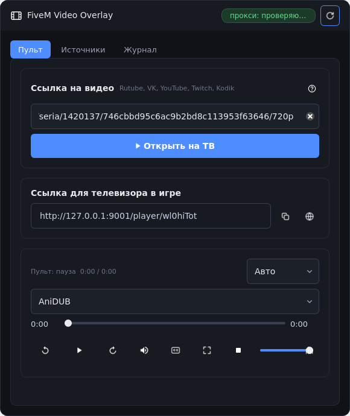
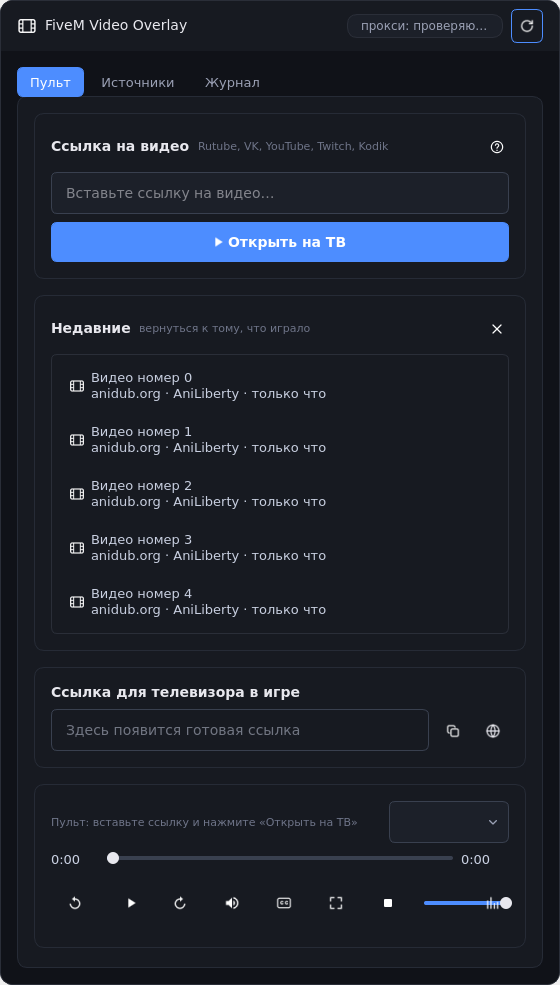
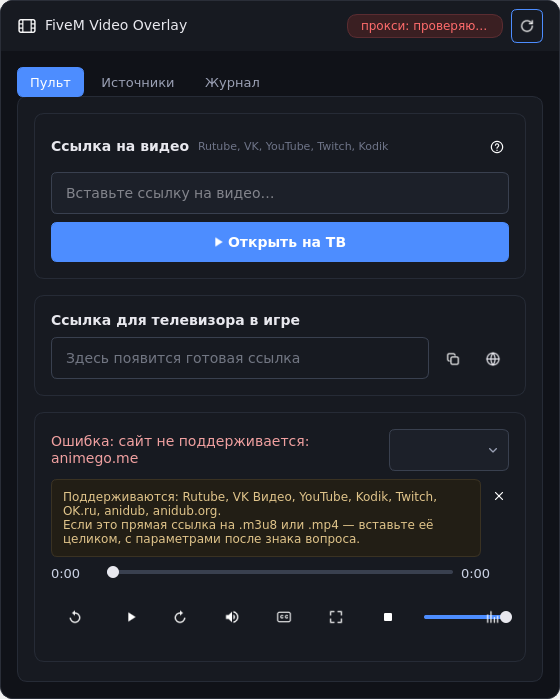
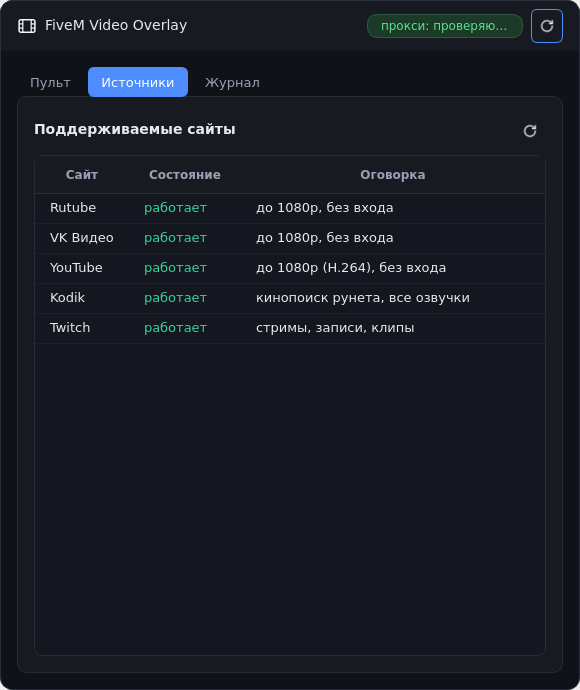
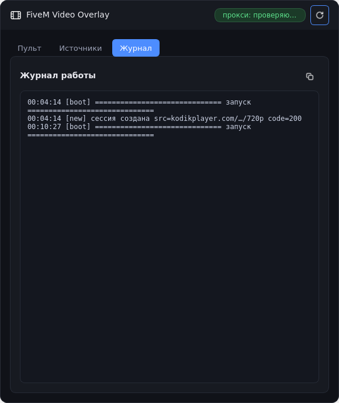
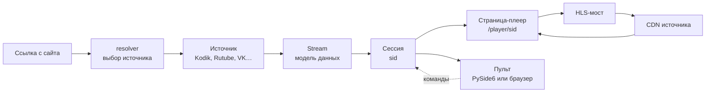

<p align="center">
  <picture>
    <source media="(prefers-color-scheme: dark)" srcset="docs/images/logo-dark.svg">
    
  </picture>
</p>

<h1 align="center">FiveM Video Overlay</h1>

<p align="center">
  Пульт и веб-плеер, которые превращают ссылку на видео в поток<br>
  и показывают его на экране внутри GTA 5 (FiveM).
</p>

<p align="center">
  <a href="https://github.com/Ven4esters/FiveM-TV-Overlay/actions/workflows/ci.yml"></a>
  <a href="README.en.md"></a>
  <a href="LICENSE"></a>
  
  
</p>

<p align="center">
  <b>Русский</b> · <a href="README.en.md">English</a>
</p>

---

## Содержание

- [Описание](#описание)
- [Возможности](#возможности)
- [Как выглядит](#как-выглядит)
- [Требования](#требования)
- [Быстрый старт](#быстрый-старт)
- [Сборка .exe](#сборка-exe)
- [Проверка файла](#проверка-файла)
- [Использование](#использование)
- [HTTP API](#http-api)
- [Архитектура](#архитектура)
- [Тесты](#тесты)
- [Ограничения](#ограничения)
- [FAQ](#faq)
- [Безопасность](#безопасность)
- [Лицензия](#лицензия)

---

## Описание

FiveM Video Overlay решает одну задачу: чтобы на сервере GTA 5 (FiveM) можно
было включить видео из интернета и показать его на экране — как на телевизоре.

Ссылка с сайта (Rutube, VK, YouTube, Twitch, Kodik и другие) приходит на
локальный сервер, тот находит внутри страницы настоящий поток и раздаёт его
странице-плееру, которую открывает игровой клиент. Одновременно на ПК работает
пульт: выбор серии и озвучки, качество, пауза, перемотка, громкость, «Недавние».

Проект рассчитан на администраторов FiveM-серверов и на тех, кто повторяет эту
схему у себя. Это не загрузчик и не медиасервер: видео никуда не сохраняется,
файлы не скачиваются, каждый раз поток запрашивается заново.

## Возможности

- **11 источников** в одной цепочке: Rutube, VK Видео, YouTube, Twitch, OK.ru,
  Kodik, Kodik (встройка), YummyAnime, Tvigle, anidub, anidub.org.
- **Серии и озвучки** переключаются на лету у Kodik, anidub и YummyAnime —
  без перезапуска плеера; на остальных источниках переключателя просто нет.
- **Качество вручную или «Авто»**: от 1080p до 360p, если сайт их отдаёт.
- **Продолжение с того же места**: «Недавние» помнят позицию и открывают видео
  на той же минуте.
- **Пульт на PySide6** и та же страница в браузере телефона — управлять можно
  откуда удобно.
- **Сборка в один .exe**: `build.bat` собирает автономный файл, которому не
  нужен установленный Python, и рядом кладёт контрольные суммы `.md5` и
  `.sha256`.
- **Замер памяти в комплекте**: `tools/bench_memory.py --quick` показывает RSS
  по этапам — сервер на старте занимает **40 МБ**, под нагрузкой **44 МБ**.
- **Отказ вместо тишины**: если сайт не поддерживается, пульт называет причину
  и перечисляет, что поддерживается (см. скриншот ниже).

## Как выглядит

Пульт — вкладка «Пульт»: поле для ссылки, кнопка «Открыть на ТВ», готовая
ссылка для игрового клиента и органы управления плеером.

<p align="center">
  
</p>

«Недавние» — то, что уже играло, с источником и озвучкой:

<p align="center">
  
</p>

Если сайт не поддерживается, пульт не молчит: он называет сайт и перечисляет
поддерживаемые источники.

<p align="center">
  
</p>

Таблица источников с честным состоянием каждого — «работает» или «частично»,
и оговоркой, чего именно не хватает (вкладка «Источники»):

<p align="center">
  
</p>

<details>
<summary>Ещё: журнал работы</summary>

<p align="center">
  
</p>

</details>

> [!NOTE]
> Демо-запись (GIF) пока не снята: см. чек-лист в `docs/images/README.md`.
> Все изображения выше — настоящие скриншоты приложения, а не макеты.

## Требования

| Компонент | Минимум | Проверка | Зачем |
|---|---|---|---|
| Python | 3.10 (проверено на 3.12 и 3.13) | `python --version` | язык проекта |
| 64-битная система | — | `python -c "import sys; print(sys.maxsize > 2**32)"` | PySide6 не ставится на 32-битный Python |
| ffmpeg | не обязателен | `python -c "import imageio_ffmpeg"` | выравнивание громкости и склейка звука YouTube |
| Windows | 10/11 | — | `start.bat` написан под Windows; остальное кроссплатформенно |

`ffmpeg` в системе ставить не нужно: пакет `imageio-ffmpeg` приносит свой
бинарник и работает без прав администратора. Без него приложение запускается,
недоступны только две функции — нормализация громкости и склейка.

## Быстрый старт

**Windows, одна команда.** Скачайте репозиторий и запустите `start.bat`:

```bat
start.bat
```

Скрипт сам создаст окружение `.venv`, поставит зависимости и откроет пульт.
Первый запуск занимает несколько минут — ставится PySide6.

**Любая система, вручную.** Три команды до работающего пульта:

```bash
python -m pip install -e .
python -m tvhost2.ui --serve --port 9001
```

Откроется окно пульта, а сервер поднимется в том же процессе. Адрес для
игрового клиента — `http://<адрес-машины>:9001/player/<sid>`, его печатает
сам пульт после первой ссылки.

<details>
<summary>Альтернативы: только сервер, без окна</summary>

Сервер без пульта — когда управлять нужно из браузера или с другого устройства:

```bash
python -m pip install -e .
tvhost --port 9001
```

Пульт тогда открывается в браузере: `http://127.0.0.1:9001/`.

Без установки пакета, прямо из исходников:

```bash
PYTHONPATH=src python -m tvhost2 --port 9001
```

Порт по умолчанию — **9001**; `--port` и `--host` меняют адрес прослушивания
(`--host` по умолчанию `0.0.0.0`, то есть сервер доступен другим машинам в
сети — это нужно игровому клиенту).

</details>

## Сборка .exe

`build.bat` собирает автономный `FiveM-Video-Overlay.exe`: пользователю не нужен
ни Python, ни установка зависимостей — скачал и запустил.

```bat
build.bat
```

Скрипт делает всё сам: проверяет Python и разрядность, создаёт **отдельное
окружение `build-venv/`**, ставит в него зависимости и PyInstaller, чистит
прошлую сборку, собирает .exe и считает контрольные суммы.
Сборка занимает **3–10 минут**, большая часть — первый запуск PyInstaller.

**`build-venv/` не зависит от `.venv/`.** Приложение может быть ни разу не
запущено через `start.bat` — сборке это не мешает: она создаёт своё окружение
с нуля. Обратное тоже верно: `start.bat` не трогает `build-venv/`, так что
удалить одно, не сломав другое, можно в любой момент. Папка внесена в
`.gitignore`.

**Что получится** в папке `dist/`:

| Файл | Для чего |
|---|---|
| `FiveM-Video-Overlay.exe` | сама программа; двойной клик поднимает пульт и сервер |
| `FiveM-Video-Overlay.exe.md5` | контрольная сумма MD5 |
| `FiveM-Video-Overlay.exe.sha256` | контрольная сумма SHA-256 |

**Требования к сборке:** Python 3.10+ (64-бит) из python.org с галочкой
«Add python.exe to PATH»; `start.bat` для сборки не нужен. 64-битная система,
~1 ГБ свободного места на время сборки (окружение сборки — около 400 МБ).
Windows — единственная поддерживаемая платформа для `.exe`.

<details>
<summary>Что внутри сборки и почему именно так</summary>

- Конфигурация лежит в `tvhost.spec`, а не в десятке флагов командной строки:
  файлов данных у проекта три (страница плеера с `hls.min.js`, стиль
  `style.qss`, папка иконок), и в командной строке их легко потерять.
- Сборка **onefile**: один файл, но при запуске он распаковывается во временную
  папку. Поэтому всё, что программа должна помнить между запусками, пишется
  рядом с `.exe`, а не в распаковку — это разведено в
  `src/tvhost2/core/resources.py`.
- **Иконка — `src/tvhost2/ui/assets/app.ico`**, та же, что на логотипе в этом
  README. Внутри неё девять размеров (16–256), поэтому Windows не растягивает
  картинку: 16 берётся для панели задач, 256 — для крупных значков в
  проводнике. Тот же файл ставится и на окно приложения (`theme.app_icon()`),
  так что значок в заголовке окна и у `.exe` совпадает и не «прыгает» при
  переключении окон.
- UPX отключён: он экономит ~20 МБ, но ломает Qt, и падения потом ищут в коде.
- Лишние модули Qt (WebEngine, Multimedia, Quick) исключены: без этого сборка
  весит сотни мегабайт вместо десятков.
- `ffmpeg` в `.exe` не вкладывается. Он берётся из `imageio-ffmpeg` или из
  `ffmpeg.exe` рядом с программой — положите его туда, если нужна нормализация
  громкости.

</details>

## Проверка файла

Готовый `.exe` раздаётся вместе с двумя контрольными суммами. Они отвечают на
два разных вопроса: **докачался ли файл целиком** (MD5 и SHA-256) и **не
подменили ли его** (только SHA-256 — MD5 для этого давно не годится).

> [!WARNING]
> Сверяйте сумму с той, что опубликована здесь или в описании релиза. Сумма,
> лежащая рядом с самим файлом на чужом сайте, ничего не доказывает: её
> подменяют вместе с файлом.

### Контрольные суммы

<!-- TODO(exe): заполнить после первой сборки build.bat.
     Порядок: собрать .exe, затем вставить сюда значения из
     dist\FiveM-Video-Overlay.exe.md5 и .sha256 и имя версии. -->

| Что | Значение |
|---|---|
| Версия | `TODO` — заполним после сборки |
| Размер файла | `TODO` — заполним после сборки |
| Дата сборки | `TODO` — заполним после сборки |
| **MD5** | `TODO` — заполним после сборки |
| **SHA-256** | `TODO` — заполним после сборки |

### Как проверить самому

**Windows, PowerShell:**

```powershell
Get-FileHash .\FiveM-Video-Overlay.exe -Algorithm SHA256
Get-FileHash .\FiveM-Video-Overlay.exe -Algorithm MD5
```

Сравните полученные строки с таблицей выше — они должны совпадать полностью,
символ в символ.

**Windows, из командной строки:**

```bat
certutil -hashfile FiveM-Video-Overlay.exe SHA256
```

**Linux или macOS:**

```bash
sha256sum -c FiveM-Video-Overlay.exe.sha256
md5sum -c FiveM-Video-Overlay.exe.md5
```

Ожидаемый вывод — `FiveM-Video-Overlay.exe: OK`. Любое другое сообщение
означает, что файл скачался не полностью или был изменён: не запускайте его,
скачайте заново.

### Проверка в VirusTotal

<!-- TODO(virustotal): заполнить после первой сборки build.bat.
     Порядок:
       1. Собрать .exe.
       2. Загрузить dist\FiveM-Video-Overlay.exe на https://www.virustotal.com
          (вкладка File, файл можно не публиковать — тогда проверка видна
          только вам, и ссылку давать бессмысленно: публикуйте).
       3. Вставить ссылку на отчёт и дату проверки в таблицу ниже.
       4. Указать, сколько движков что нашли: пустая колонка честнее
          выдуманного «0/70». -->

| Что | Значение |
|---|---|
| Ссылка на отчёт VirusTotal | `TODO` — появится после первой сборки |
| Дата проверки | `TODO` |
| Результат | `TODO` — например, `0/72` или список сработавших движков |

<details>
<summary>Почему для неподписанного .exe бывает «1–3 обнаружения»</summary>

Собранный PyInstaller файл не имеет цифровой подписи, а внутри у него
упакованы Python и Qt. Часть антивирусов на это реагирует эвристикой и пишет
что-то вроде «Trojan.Generic» или «Wacatac» — это ложное срабатывание, а не
вирус. Проверить просто: у настоящего срабатывания совпадает **детект у
нескольких известных вендоров** и есть поведенческий отчёт; у эвристики —
одна-две малоизвестные строки.

Ещё два способа снять вопрос:

- **Собрать самому** из этого репозитория: `build.bat` даёт файл из
  исходников, которые вы видите. Сумма будет другой — сборка не
  воспроизводится побайтово, и это нормально.
- **Запустить из исходников** без `.exe` вообще: см. «Быстрый старт».

</details>

## Использование

### Открыть видео на телевизоре

1. Вставьте ссылку на страницу с видео в поле «Ссылка на видео».
   Подходит адрес страницы, а не обязательно прямой файл.
2. Нажмите **«Открыть на ТВ»**. Пульт покажет готовую ссылку вида
   `http://127.0.0.1:9001/player/wI0hiT0t`.
3. Эту ссылку откройте в игровом клиенте (в игре — на экране-телевизоре).
4. Дальше плеером управляет пульт: пауза, перемотка на 10 секунд, громкость,
   качество, озвучка.

Результат: на экране в игре играет поток, в пульте видно время `0:00 / 24:37`
и текущую дорожку (например, «AniDUB»).

### Переключить серию или озвучку

Серии и озвучки — общий механизм для всех источников, которые их умеют
(Kodik, anidub, YummyAnime). Список приходит вместе с потоком и показывается
в выпадающем списке пульта. Если сайт серий не отдаёт — переключателя нет
вовсе, а не «есть, но не работает».

### Вернуться к тому, что играло

Раздел «Недавние» хранит последние **5** видео с источником, озвучкой и
позицией. Клик возвращает к тому же месту.

## HTTP API

Сервер — обычный HTTP, поэтому пультом может быть что угодно: браузер, скрипт,
другая программа. Все ответы — JSON.

| Метод и путь | Что делает |
|---|---|
| `GET /` | Имя и версия приложения |
| `GET /sessions` | Что сейчас запущено: `sid`, название, источник |
| `GET /sources` | Источники и их состояние (`ok` / `partial`) с оговорками |
| `GET /history` | «Недавние» |
| `GET /state/<sid>` | Состояние плеера: время, пауза, качество, озвучка |
| `GET /player/<sid>` | Страница-плеер для игрового клиента |
| `POST /new?url=<ссылка>` | Создать сессию: ссылка → поток. Вернёт `sid` |
| `POST /control/<sid>?cmd=pause` | Команды плееру — см. таблицу ниже |
| `GET /commands/<sid>?since=<seq>` | Команды, накопившиеся после `seq` (так игра узнаёт о нажатиях) |
| `GET /diag` | Журнал работы |

Команды `cmd` для `/control/<sid>`. Значение передаётся в `value`:

| `cmd` | `value` | Что делает |
|---|---|---|
| `play` / `pause` / `toggle` | — | запустить, пауза, переключить |
| `seek` | секунды | перейти на позицию (в прямом эфире недоступно) |
| `seekRel` | ±секунды | перемотка относительно текущей |
| `quality` | высота, например `720`, или `0` | качество вручную; `0` — «Авто» |
| `trans` | номер дорожки | сменить озвучку |
| `subs` | номер | сменить субтитры |
| `volume` | 0…1 | громкость |
| `mute` | `true` / `false` | звук вкл/выкл |
| `normalize` | `true` / `false` | выравнивание громкости (нужен ffmpeg) |
| `restart` | — | начать сначала |
| `fullscreen` | `true` / `false` | полный экран |

```bash
# создать сессию и посмотреть, что получилось
curl -X POST "http://127.0.0.1:9001/new?url=https://rutube.ru/video/..."
curl "http://127.0.0.1:9001/sessions"
```

## Архитектура

Поток данных — от ссылки до экрана в игре:



- **`sources/`** — по одному классу на сайт. Каждый умеет `matches(url)` и
  `resolve(url)`; добавить источник — зарегистрировать класс в реестре.
  Реестр — единственное место, где источники перечислены.
- **`core/`** — общая модель `Stream`, кэши с пределом, работа с ffmpeg,
  реестр. Здесь нет ни интерфейса, ни сети напрямую.
- **`web/`** — HTTP-сервер, сессии, HLS-мост (он подменяет пути в мастер-
  плейлисте, потому что CDN отдаёт относительные) и страница плеера.
- **`ui/`** — пульт на PySide6. Без бизнес-логики: только отображение и вызовы
  HTTP API.

Правила слоёв и вклад в проект — `CONTRIBUTING.md`.

## Тесты

```bash
python -m pytest                                  # 493 теста
python -m pytest -m "not browser and not network" # быстрый прогон без живых сайтов
ruff check src tests tools                        # линтер
mypy src                                          # типы
```

Покрытие — **68 %** порог, считается по `src/tvhost2` (`pytest --cov`).
Браузерным тестам нужен Chromium: `playwright install --with-deps chromium`.
Сетевые тесты ходят на живые сайты и потому не блокируют мерж.

Статус проверок — на бейдже CI выше; последний прогон зелёный.

## Ограничения

Честно о том, чего нет:

- **Ссылки на видео никуда не сохраняются.** Сессия живёт 6 часов, после
  перезапуска всё начинается заново — ссылки CDN к тому времени мертвы.
- **Региональные блокировки не обходятся.** Tvigle из-за границы не играет,
  YummyAnime отдаёт только часть плееров — так и написано в таблице источников.
- **DDoS-Guard и капчи не обходятся.** Это не поддержка сайта, а обход защиты.
- **Скачивания нет.** Проект показывает поток, а не собирает библиотеку.
- **Windows — основной путь.** `start.bat` написан под неё; сервер и пульт
  кроссплатформенны, но на Linux они проверяются в CI, а не в игре.
- **Пульт — обычное окно Windows, а не внедрённый оверлей.** Он висит поверх
  («Always On Top»), но в эксклюзивном полноэкранном режиме окна могут терять
  фокус — играйте в режиме **Borderless**. Внутриигровой оверлей без паузы
  игры возможен только ресурсом на стороне сервера FiveM.
- **GTA Online — не место для стороннего софта.** Проект не внедряется в игру
  и не читает её память, но правила Rockstar к любому стороннему софту
  относятся настороженно. Используйте в одиночной игре (Story Mode).

## FAQ

<details>
<summary>«Сайт не поддерживается» — что делать</summary>

Пульт называет сайт и перечисляет поддерживаемые. Если нужен прямой файл —
вставьте ссылку на `.m3u8` или `.mp4` целиком, с параметрами после знака
вопроса: обрезанная ссылка не откроется.
</details>

<details>
<summary>Порт 9001 занят</summary>

Запустите на другом порту — `tvhost --port 9002` или
`python -m tvhost2.ui --serve --port 9002`. Пульт подключается к тому же порту,
на котором поднят сервер.
</details>

<details>
<summary>В игре чёрный экран, звук есть</summary>

Проверьте, что игровой клиент открывает адрес именно того компьютера, где
работает сервер (не `127.0.0.1`, если игра на другой машине), и что порт
открыт в брандмауэре. Сервер слушает `0.0.0.0` по умолчанию.
</details>

<details>
<summary>Громкость не выравнивается, YouTube идёт без звука</summary>

Нужен ffmpeg. Проверьте `python -c "import imageio_ffmpeg; print(imageio_ffmpeg.get_ffmpeg_exe())"` —
если путь не печатается, переустановите зависимость: `pip install imageio-ffmpeg`.
</details>

<details>
<summary>Видео не играет — как прислать отчёт</summary>

Вкладка **«Журнал»** — первый инструмент поиска причин. Нажмите кнопку
копирования рядом с заголовком «Журнал работы»: в буфере окажется журнал целиком,
включая снимок окружения (Python, yt-dlp, ffmpeg, пути).

Что смотреть в первую очередь:

| Метка | Значение |
|---|---|
| `req` | запрос прошёл, код 2xx/3xx |
| `ОШИБКА` | CDN отказал или обрыв — с кодом и текстом |
| `ИГРА` | ошибка, присланная браузером телевизора (hls.js) |
| `boot` | страница открылась в телевизоре: его User-Agent, загрузился ли hls.js |
| `new` | сколько секунд заняла подготовка ссылки |

- **Есть `boot`, ошибок нет** — страница открылась, но видео не пошло. Если в
  строке `hls=НЕ загружен`, телевизор не смог получить `/static/hls.min.js`.
- **Нет ни одного `boot`** — телевизор не достучался до сервера: неверный IP
  в ссылке, другая сеть или брандмауэр Windows.
- **`CDN не отдал плейлист … code=403/404`** — ссылка устарела или CDN
  блокирует IP. Нужна свежая ссылка из пульта.
- **`fragLoadErrorTimeOut`** — сеть не тянет качество: поставьте 360p вместо «Авто».

</details>

<details>
<summary>Пульт не открывается на машине без экрана (сервер, CI)</summary>

Запускайте только сервер: `tvhost --port 9001`. Пульт тогда доступен в браузере
по адресу сервера, PySide6 на headless-машине не нужен.
</details>

## Безопасность

- **Уязвимости не через публичные issue.** Пишите приватно через
  [GitHub Security Advisories](https://github.com/Ven4esters/FiveM-TV-Overlay/security/advisories/new).
- **Сервер по умолчанию слушает `0.0.0.0`** и не требует авторизации — он
  рассчитан на доверенную локальную сеть. Не выставляйте порт в интернет без
  прокси с авторизацией.
- **Секретов в репозитории нет.** Токенов, ключей и личных данных в коде и
  документации не хранится; токены для доступа к GitHub лежат вне репозитория.

## Лицензия

Проект распространяется под лицензией **MIT**. Полный текст — в файле
[LICENSE](LICENSE).

---

<p align="center">
  <sub>Версия 2.1.0 · поддерживается только v2.1; код v1 остался тегом <code>v1.0-working</code> и не развивается</sub>
</p>
