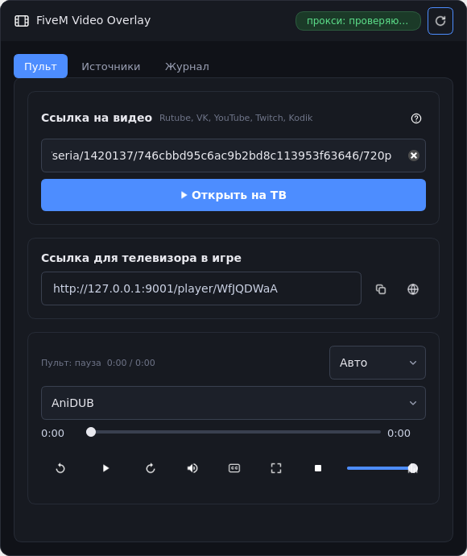
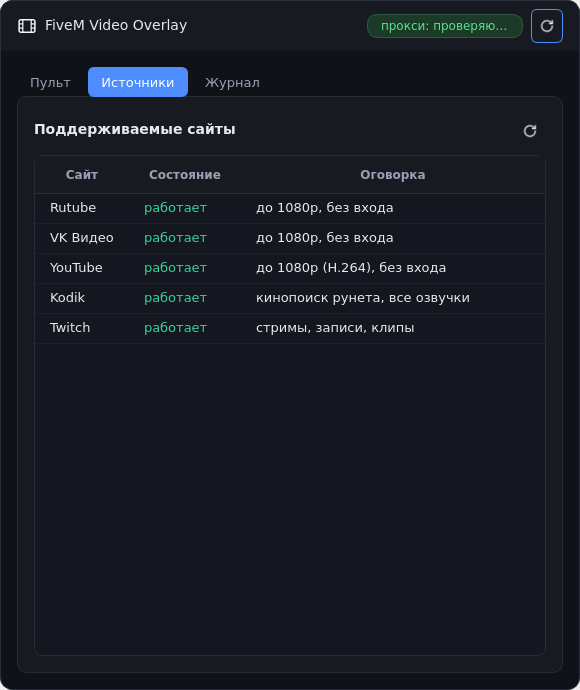
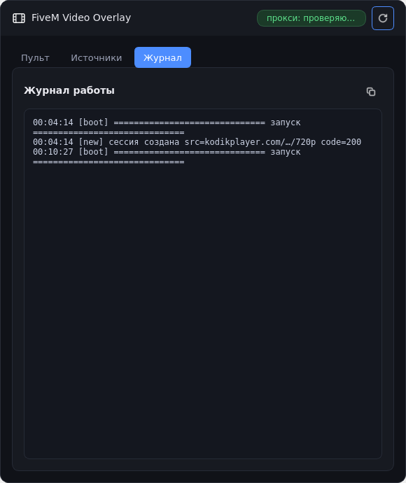

# FiveM Video Overlay 2.0 — как запустить

Версия 2.0 — это одно окно-пульт и локальный прокси. Вы вставляете ссылку,
окно выдаёт адрес для телевизора в игре. Видео идёт напрямую с источника,
ничего не скачивается на диск.

Скриншоты ниже сняты с работающего приложения, не макеты.



---

## 1. Установка

Нужен Python 3.12 и три пакета.

```bash
pip install PySide6 yt-dlp requests
```

`ffmpeg` — по желанию: он нужен только для выравнивания громкости. Без него
всё остальное работает, кнопка «Выравнивать громкость» просто скажет, что
замера нет.

## 2. Запуск — одна команда

```bash
python -m tvhost2.ui --serve
```

Окно откроется, и прокси поднимется в этом же процессе на порту 9001.
Закрыли окно — прокси остановился. Ничего дополнительно запускать не нужно.

Если прокси уже работает отдельно (например, на другой машине), запускайте
окно без `--serve` и укажите порт:

```bash
python -m tvhost2.ui --port 9001
```

## 3. Работа

1. Вставьте ссылку в поле «Ссылка на видео» и нажмите **Открыть на ТВ**.
2. Во втором поле появится готовая ссылка. Она уже в буфере обмена —
   вставьте её в телевизор в игре.
3. Управляйте воспроизведением с пульта: пауза, перемотка ±10 секунд,
   громкость, качество, озвучка.

### Вкладка «Источники»



Видно, что работает прямо сейчас и с какой оговоркой. Например, у Rutube
написано «до 1080p, без входа» — значит вход не нужен, качество ограничено
источником. Если источник сломался, здесь будет «не работает» с причиной,
а не молчаливая ошибка в пульте.

### Вкладка «Журнал»



Каждое действие пишется строкой. Если что-то пошло не так, здесь видно, на
каком адресе и какой код ответа. Эту строку можно скопировать и прислать мне
— по ней видна причина без догадок.

Формат строки:

```
00:04:14 [new] сессия создана src=kodikplayer.com/…/720p code=200
```

`[new]` — создана сессия, `[req]` — запрос к источнику, `[err]` — ошибка,
`[boot]` — запуск. Журнал хранится в `videos/cache/overlay.log` и переживает
перезапуск.

---

## Управление с пульта

| Кнопка | Что делает |
|---|---|
| ▶ / ⏸ | пуск и пауза |
| ⟲ ⟳ | назад и вперёд на 10 секунд |
| Громкость | ползунок, значение уходит в телевизор |
| Эквалайзер | выравнивание громкости под стандарт |
| Субтитры | включить дорожку, если источник её отдаёт |
| Качество | «Авто» подбирает под скорость сети, иначе фиксированное |
| Озвучка | список дорожек Kodik и подобных сайтов |
| Полный экран | развернуть картинку в телевизоре |

## Какие сайты поддерживаются

Rutube, VK Видео, YouTube, Twitch (стримы, записи, клипы), Kodik.

## Если что-то не работает

**Окно пишет «прокси не отвечает».** Прокси не запущен. Запустите с `--serve`
или проверьте порт в бейдже шапки: он должен совпадать с тем, что вы указали
в `--port`.

**Ссылка открылась, а в телевизоре чёрный экран.** Откройте вкладку «Журнал»:
там будет код ответа источника. Код 403 — источник требует вход или
ограничил доступ, код 404 — видео удалено.

**Нет звука.** Проверьте ползунок громкости: он управляет телевизором в игре,
а не системной громкостью.
